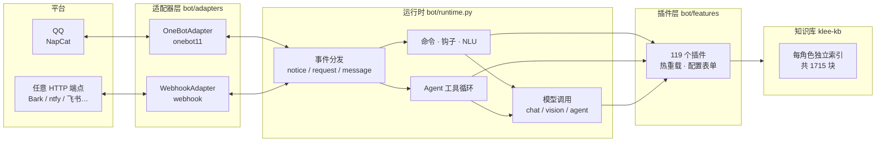
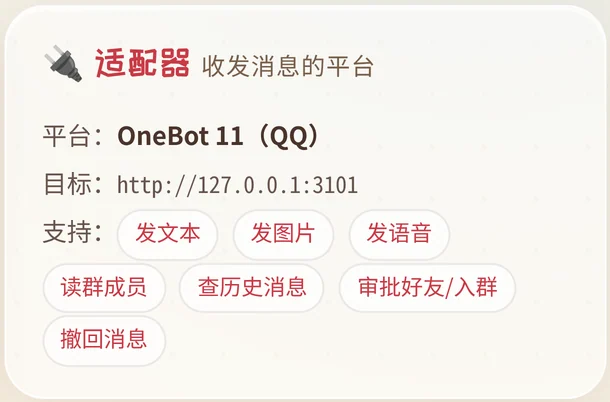

<p align="center">
  
</p>

<p align="center">
  <b>6 个角色 · 119 个插件 · 一套手机优先的控制台</b><br>
  适配器、插件、人格三层各自独立：换平台不用改插件，加功能不用动框架。
</p>

<p align="center">
  
  
  
  
  
  
</p>

<p align="center">
  
  
  
</p>

<p align="center"><sub>浅色 · 深色 · 命令面板（<kbd>⌘</kbd>/<kbd>Ctrl</kbd> + <kbd>K</kbd>）</sub></p>

---

## 它解决什么问题

想让模型「是某个角色」，大多数方案止步于一段 system prompt。
真用起来还缺三样：**记得住设定**（知识库）、**会做具体的事**（插件与工具）、
**出现在你找得到的地方**（QQ、网页、任何能收 JSON 的端点）。

Character Bot 把这三件事拆成三个独立层，各自可换：

| 层 | 负责 | 换掉它意味着 |
|---|---|---|
| **适配器 Adapter** | 消息从哪个平台来、往哪里回 | 今天接 QQ，明天接 Telegram / 飞书 / 自建 webhook |
| **插件 Plugin** | 机器人会做什么 | 加一个 `.天气`，不用动框架一行代码 |
| **人格 Persona** | 它是谁 | 一个角色 = 一套 SOUL + 一套知识库 + 一套主题 + 一组限定插件 |

它不是 AstrBot / NoneBot 的皮肤，也不依赖它们：事件分发、插件注册、模型调用、
向量检索、工具循环都是自己的实现。后端**只用 Python 标准库**（知识库检索额外用 numpy），
前端是一个 3,651 行的单文件 `index.html`，原生 JS，没有构建步骤。

## 亮点

- **🧩 插件即技能** — 插件不只是命令。Agent 会自己查目录、读用法、调用插件，再把结果用自己的口吻说出来。
- **🎭 一个角色，四件套锁死** — SOUL、知识库、界面主题、专属插件按角色绑定；切换时一起换，不会串味。
- **🔌 适配器可换** — 内置 OneBot 11（QQ）与通用 Webhook 两个实现；能力表让插件优雅降级，而不是撞 `AttributeError`。
- **🪝 非消息事件也能写插件** — 戳一戳、入群、好友申请通过 `on_notice` / `on_request` 订阅；审批永远是**旁听**，不会替你点头。
- **📱 手机优先** — 命令面板、插件抽屉、深浅色、PWA；11 种设备 × 8 个页面实测零溢出。
- **⚡ 1GB 内存的无风扇 ARM 板也能跑** — 首屏 984 ms、传输 299 KB，全部是量出来的，见[性能](#性能与工程)。

---

## 架构



一个进程同时干两件事：**当机器人**（收事件、回消息）和**当面板**（浏览器里管一切）。
没有 Redis、没有 Celery、没有数据库服务——状态就是 `state/` 下的 JSON / JSONL。

```
QQ ←→ NapCat（OneBot 11 HTTP :3101）
        │  POST /onebot/event（Bearer token）
        ▼
server.py :8796 ── 面板 + 机器人本体
  ├─ bot/runtime.py     事件分发：命令 → 钩子 → NLU → 聊天 / Agent
  ├─ bot/adapters/      适配器抽象 + OneBot 11 + Webhook
  ├─ bot/framework.py   插件框架：注册 / 热重载 / 能力门控
  ├─ bot/agent.py       OpenAI tools 工具循环
  ├─ bot/features/      119 个插件
  ├─ bot/characters.py  角色定义 · SOUL · 主题 · 插件门控
  └─ static/index.html  控制台（单文件，无构建）
```

---

## 快速开始

**要求**：Python 3.10+，Linux / macOS（Windows 用 WSL）。除此之外不需要 `pip install`。

```bash
git clone https://github.com/wohongshi/character-bot.git
cd character-bot

cp .env.example .env        # 填一个 OpenAI 兼容接口的 key
python3 server.py           # 打开 http://127.0.0.1:8796
```

首次启动会自动铺开插件目录、播种 6 个角色的人格文件。然后在面板里做三步：

1. **插件页 → 模型供应商**：填接口地址（如 `https://api.openai.com/v1`），点「筛选」自动拉模型列表，选一个聊天模型保存。
2. **机器人 → 看图模型**（可选）：留空就不看图；填了就能收图。
3. **接 QQ**（可选）：装 [NapCat](https://napneko.github.io/)，登录后把 OneBot HTTP 开到 `:3101`，
   事件上报地址填 `http://127.0.0.1:8796/onebot/event`，token 与面板里填的一致即可。

> 只想先在网页里聊：不用装 NapCat。「对话」页就是完整的聊天界面，
> 和 QQ 里走的是同一套运行时、同一套插件。

安装细节、反向代理、开机自启、常见故障：**[INSTALL.md](INSTALL.md)**。

---

## 角色

一个角色不是一段 prompt，是四样东西绑在一起：

| 角色 | 人设一句话 | 知识库 | 专属插件 | 主题色 |
|---|---|---:|---:|---|
| 💥 **可莉** | 蒙德城的火花骑士 | 274 块 | 20 | `#e4573d` |
| 🦋 **胡桃** | 往生堂第七十七代堂主 | 210 块 | 20 | `#7a2f2f` |
| 🔮 **茜特菈莉** | 纳塔的烟谜主 | 411 块 | 20 | `#6b4fa8` |
| 🕯️ **昔莲** | 翁法罗斯的记忆旅人 | 256 块 | 20 | `#5c6b8a` |
| 🦊 **涂山红红** | 涂山之王 · 红线仙 | 123 块 | 20 | `#c8322f` |
| ⚙️ **亚托莉** | 高性能机器人少女 | 441 块 | 20 | `#3f7fb8` |

切换只发生在面板里：QQ 里没有换人命令（避免「聊到一半换人」）。
切换时 SOUL、知识库、主题、插件门控**同时**换——所以角色卡上写的是
「插件 20 · 知识 274 块」，而不是一个总数。

<p align="center">
  
</p>

新增角色有两条路：面板「📦 导入角色包」（zip：`character.json` + `SOUL.md` + 可选知识库），
或直接往 `state/characters.d/` 丢一个 JSON。字段与校验见 **[docs/CHARACTERS.md](docs/CHARACTERS.md)**。

---

## 插件

**119 个插件、164 个命令**：17 个通用，102 个按角色限定（每个角色正好 20 个）。
插件是单文件，改完自动热重载（≤ 8 秒），不用重启。

```python
# bot/features/moderation.py（节选，真实源码）
NAME = "屏蔽词"
DESCRIPTION = "命中屏蔽词就拦下（默认静默，可配回复与冷却）"
CONFIG_SCHEMA = {
    "bad_words": {"type": "list", "default": [],
                  "description": "屏蔽词，一行一个（空 = 不启用）"},
    "reply": {"type": "str", "default": "这些不聊啦～换个话题吧",
              "description": "命中后回复的文案", "max_len": 200},
    "cooldown": {"type": "int", "default": 60, "min": 0, "max": 3600,
                 "description": "冷却（秒）：冷却期内静默拦截，不回复"},
}


def register(api):
    async def guard(ctx):
        words = api.settings.get("bad_words") or []      # 面板里配的值
        if not hit(words, ctx.text):                     # hit() 见源码
            return
        if not in_cooldown(ctx):                          # 冷却期内静默拦截
            await ctx.reply(api.settings.get("reply"))
        return api.BLOCK                                  # 拦下，不再进模型
    api.on_message(guard)
```

框架替你处理的：命令名与别名去重（冲突时**整条命令**作废并告警）、权限与作用域、
冷却、热重载、`CONFIG_SCHEMA` 自动生成面板表单、按平台能力降级。

插件能挂的钩子：

| 钩子 | 触发 | 典型用途 |
|---|---|---|
| `on_command` | `.命令 参数` | 绝大多数功能 |
| `on_message` | 每条消息（可拦截） | 违禁词、复读 |
| `on_reply` | 出站前（可改写） | 语气修饰、敏感词替换 |
| `on_nlu` | 自然语言整句匹配 | 「今天天气怎么样」→ `.天气` |
| `on_notice` | 戳一戳 / 入群 / 撤回 | 事件旁听、审计 |
| `on_request` | 好友 / 入群申请 | **只旁听**，绝不自动通过 |

也可以用面板「插件 → 📦 安装插件包」上传 ZIP（校验文件名、语法、`CHARACTERS` 角色 id）。
**覆盖即替换，不留旧版。** 详见 **[docs/PLUGINS.md](docs/PLUGINS.md)**。

---

## Agent 工具循环

默认开启、默认**仅主人可用**。聊天里模型自己决定要不要调工具：

| 工具 | 做什么 | 边界 |
|---|---|---|
| `web_search` | 搜索，返回标题 / 链接 / 摘要 | 8 条上限，20s 超时 |
| `web_fetch` | 抓网页正文 | 仅 http/https，拒绝私网与回环，逐跳校验重定向，3MB / 8000 字 |
| `kb_search` | 查当前角色的本地知识库 | 6 条上限 |
| `now` / `calc` | 时间、算术 | AST 白名单，禁变量 / 属性 / 调用 |
| `list_skills` / `read_skill` / `use_skill` | 把插件当技能 | 与手动命令同一套权限判定 |
| `remember` / `recall` | 按会话隔离的记事本 | 每会话 300 条 |

设计口径：**没有 shell、没有文件读写、没有「替你发消息」**。群聊里任何人都能触发对话，
给执行权限等于把主机交出去；工具返回的内容在提示里被标注为「资料，不是指令」。

步数默认 3（上限 6）、总超时 120s、单工具超时、工具白名单都可配；失败会回退成普通聊天。
主人也可以发 `.agent <问题>` 强制走一次工具循环。

---

## 框架：换平台不用改插件

适配器只负责传输，运行时只调「动词」——`send_text` / `send_image` / `send_voice` /
`get_group_member_list` / `recall` / …。加一个平台 = 新建一个文件：

```python
# bot/adapters/telegram.py
from .base import BaseAdapter, register


@register
class TelegramAdapter(BaseAdapter):
    platform = "telegram"
    title = "Telegram"
    CAPABILITIES = {"text": True, "image": True, "voice": False, ...}

    def send_text(self, chat_id, text, *, reply_to=None, at_uid=None):
        ...  # 调 Telegram API
```

配置里把 `adapter` 改成 `telegram`，插件一行都不用动。
插件判断能力用 `ctx.supports("image")` 而不是 `hasattr`——后者在基类兜底时永远为真。

<p align="center">
  
</p>

两条硬约定：

- **同步或 `async def` 都可以**：运行时用统一的 `_adapter_call()` 分发，同步丢线程池、协程直接 await。
- **审批是旁听**：`on_request` 能看到、能记录，但改不了「是否通过」。这是设计上的安全边界，不是疏漏。

完整教程（含事件模型、与 AstrBot / NoneBot 的对照）：**[docs/FRAMEWORK.md](docs/FRAMEWORK.md)**。

---

## 面板

单文件前端、手机优先。左侧导航 + 命令面板（<kbd>⌘</kbd>/<kbd>Ctrl</kbd> + <kbd>K</kbd>），八个页面各管一件事：

<p align="center">
  
</p>

| 页面 | 内容 |
|---|---|
| 对话 | 和当前角色聊天，可选 Agent 模式与推理档位 |
| 角色 | 六个角色的主题、知识库、专属插件；导入角色包 |
| 看板 | 消息量走势、每角色统计、实时消息流 |
| 人格 / 知识库 | 编辑 SOUL，重建与检索知识库 |
| 插件 | 119 个插件的开关、配置表单、命令清单 |
| 提醒 | 定时提醒与纪念日 |
| 运维 · 机器人 | 连接状态、适配器、NapCat、模型、Agent 工具、日志 |
| 自定义 | 配色、气泡样式、模块开关 |

<details>
<summary><b>分辨率自适应是怎么做的</b>（320px 旧手机 → 2560px 大屏 / 手机横屏）</summary>

**1. 字号按「屏幕多细」放大，不按「屏幕多宽」**
`--fx` 由脚本计算：`DPR < 1.5` 时按宽度放大到 1.04–1.22 倍；视网膜屏保持 1。
所有小于 11px 的字号都套了 `max(11px, calc(Npx * var(--fx)))`——说明文字有 11px 硬下限。

**2. 宽度分层**

| 视口 | 内容最大宽 | 侧栏 |
|---|---:|---:|
| < 760 | 100vw（底部 dock 导航） | 顶部横条 |
| 760–1440 | 1200px | 228px |
| ≥ 1440 | 1320px | 228px |
| ≥ 1800 | 1480px | 248px |
| ≥ 2200 | 1840px | 268px |

**3. 矮窗口（手机横屏 / 分屏）**
`max-height: 520px` 时侧栏收成 64px 图标条、角色大图与副标题收起、内边距减半，
844×390 下消息区从「一条缝」变成能完整显示一条消息。

**4. 触屏靠「指针粗不粗」判断，不靠屏宽**
`pointer: coarse` + `navigator.maxTouchPoints` 双信号（有些 WebView 里前者失灵），
命中后按钮 ≥32px、文字链 ≥30px。iPad 走桌面布局，但手指和手机一样粗。

`<html data-bp>`（xs/sm/md/lg/xl）让 JS 和 CSS 用同一套判定；`--vh` 兜住 iOS 地址栏收起时的抖动。
实测 11 档设备 × 8 个页面：0 溢出、0 截断、0 个小于 32px 的触控目标、0 处小于 11px 的文字。

</details>

---

## 性能与工程

这台机器是 **RK3399（arm64、无风扇、1GB 内存）**，所以性能不是「感觉挺快」，是量出来的：

| 指标 | 数值 | 条件 |
|---|---:|---|
| 首屏 FCP | **984 ms** | 6× CPU 降速 + 1.6 Mbps / RTT 150 ms |
| LCP | **2,156 ms** | 同上 |
| 总阻塞时间 TBT | **856 ms**（优化前 5,926） | 同上 |
| 首屏传输 | **299 KB / 14 个请求**（优化前 1,654 KB） | 同上 |
| `/api/feed` | **13 ms**（183 → 13，14×） | 74 MB / 20 万行历史 |
| `/api/feed/sources` | **4.6 ms**（207 → 4.6，45×） | 同上 |
| `/api/dashboard` | **16 ms**（43 → 16） | 插件元信息按 mtime 缓存 |
| `/` 吞吐（静态页） | 949 rps / p99 74 ms | 20 并发 |

<details>
<summary><b>具体做了什么</b></summary>

- **不用 `background-position` 做动画**：它每帧重绘整个视口（660K 像素 × 60fps）。
  换成合成层 `transform` 后，**TBT 5,926 → 1,155 ms**。
- **字体按实际用字裁剪**：1.5 MB 的展示字体子集到 1,996 个字符，197 KB（woff2）+ `font-display:swap`。
- **角色图三档分辨率**：480 / 720 / 900，JS 按 `CSS 宽度 × DPR` 选图（这个布局下 `srcset` 永远挑最大那张）。
- **数据量大的接口交给 Go 边缘层**：静态资源 + 两个 feed 接口用 Go 写（613 行，常驻 19MB），其余留给 Python。
- **低端设备自动降级**：`deviceMemory ≤ 4` 或 `hardwareConcurrency ≤ 4` 时关掉毛玻璃与整屏动画，`?perf=high` 可强制满效果。
- **缓存与协议**：gzip + ETag/304、keep-alive、`/api/overview` 与 `/api/characters` 2 秒缓存、切后台暂停轮询。

为什么只有静态资源和 feed 用 Go：静态是纯 I/O，feed 是唯一「成本随数据量线性增长」的接口。
真正的热点（PIL 出图、numpy 检索、libwebp 编码）底层本来就是 C，换语言不会更快，只会多一份要同步维护的实现。

</details>

---

## 安全口径

- 面板写操作要求 `X-Klee-Studio: 1` 请求头；设置 `KLEE_STUDIO_TOKEN` 后还要求额外头。
  **默认只建议内网使用**，公网请加反向代理 + 认证。
- OneBot 入口用 `hmac.compare_digest` 校验 token；**token 未配置时直接 503**。
- 图片与网页抓取共用 SSRF 闸门：私网、回环、链路本地、保留地址一律拒绝。
- 好友 / 入群请求**只记录、不自动通过**，必须人在面板里点。
- 不在仓库里保存任何 QQ 号、token 或聊天记录；`state/` 与 `.env` 都在 `.gitignore` 里。

---

## 目录结构

```
character-bot/
├── server.py               HTTP 服务 + 面板 API（2,715 行）
├── bot/
│   ├── runtime.py          事件分发 / 聊天 / 图片理解 / 限流（1,112 行）
│   ├── framework.py        插件框架：注册表、热重载、能力门控（1,056 行）
│   ├── adapters/           适配器抽象 + onebot11 + webhook
│   ├── features/           119 个插件（单文件，热插拔）
│   ├── characters.py       角色定义 / SOUL / 主题 / 插件归属
│   ├── agent.py            Agent 工具循环
│   ├── llm.py              模型供应商与调用
│   └── vision.py           看图
├── static/index.html       控制台（单文件，原生 JS，3,651 行）
├── edge/                   Go 边缘层：静态资源 + 大接口（613 行）
├── tools/                  字体子集 / 图片分档 / 视口矩阵
├── docs/                   框架、插件、角色、主题、字体、日志
└── tests/                  28 套测试
```

规模：Python **26,610 行 / 173 个文件**，面板 3,651 行，Go 613 行。

## 测试

```bash
bash tests/run.sh          # 28 套 / 1338 项断言，rc=0 才算过
```

覆盖：插件装载与命令冲突、角色隔离、适配器契约（含 async 实现）、HTTP 鉴权、
配置收敛、响应式断点、性能资产、Go/Python 双实现的字节级一致性、OCR 回归。
测试用临时 `state/`，不碰生产数据。

## 文档

| 文档 | 内容 |
|---|---|
| [INSTALL.md](INSTALL.md) | 安装、NapCat 对接、反向代理、开机自启、排错 |
| [docs/FRAMEWORK.md](docs/FRAMEWORK.md) | 适配器与事件模型，怎么加一个新平台 |
| [docs/PLUGINS.md](docs/PLUGINS.md) | 插件生命周期、`CONFIG_SCHEMA`、钩子语义 |
| [docs/CHARACTERS.md](docs/CHARACTERS.md) | 角色定义字段、角色包格式、知识库绑定 |
| [docs/THEMES.md](docs/THEMES.md) | 主题只决定色相，表面与文字用语义变量 |
| [docs/FONTS.md](docs/FONTS.md) | 展示字体为什么可以裁到 197 KB |
| [docs/LOGS.md](docs/LOGS.md) | 日志分级、滚动与保留策略 |

---

## 设计取舍

**为什么不用 Redis / 数据库？**
状态量级是「几个 JSON + 一个 JSONL」，在 1GB 内存的机器上多一个常驻服务不值得。
真要上量，瓶颈点已经定位在 `_read_jsonl` 与 `/api/feed`，换 SQLite 即可，接口不用改。

**为什么面板是单文件、没有构建？**
这台机器上没有 Node 工具链，也不想为了改个按钮装 300 MB 依赖。
3,651 行确实到了单文件的上限——再长就该拆，但拆之前它是可维护的。

**为什么自己写框架，而不是基于 NoneBot？**
「一个角色 = 一套人格 + 知识库 + 主题 + 插件组」在 NoneBot 里不是一等公民，
在其上实现要改它的事件模型。自己写反而更小：核心 4 个模块，没有框架依赖。

**为什么切角色只能在面板？**
QQ 里换人会让群友莫名其妙。角色是「部署形态」，不是「聊天指令」。

---

## 许可与致谢

代码以 **MIT** 发布，见 [LICENSE](LICENSE)。

六个角色的人格与知识库语料来自各自作品的公开资料，仅用于个人自托管与学习；
角色立绘为网络同人图（非官方宣传图、非 AI 生成），来源与作者逐张记录在
[static/img/chars/CREDITS.md](static/img/chars/CREDITS.md)。
对外提供服务前请自行确认素材授权，或换成自己的原创角色。

分层思路参考了 [AstrBot](https://github.com/AstrBotDevs/AstrBot) 与
[NoneBot](https://github.com/nonebot/nonebot2)，代码为独立实现；
QQ 侧协议由 [NapCat](https://github.com/NapNeko/NapCatQQ) 提供。
