<p align="center">
  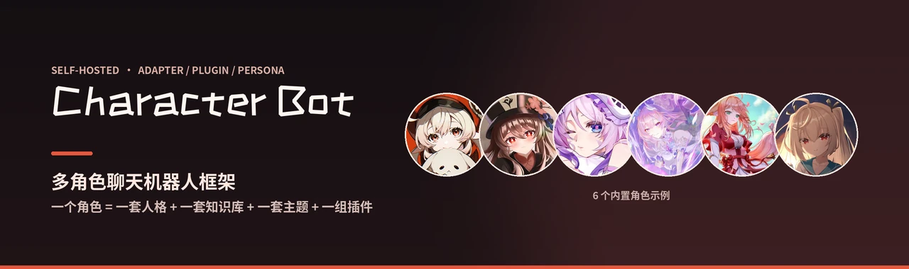
</p>

<p align="center">
  <b>6 个角色 · 150 个插件 · 一套手机优先的控制台</b><br>
  适配器、插件、人格三层各自独立：换平台不用改插件，加功能不用动框架。
</p>

<p align="center">
  
  
  
  
  
  
</p>

<p align="center">
  
  
  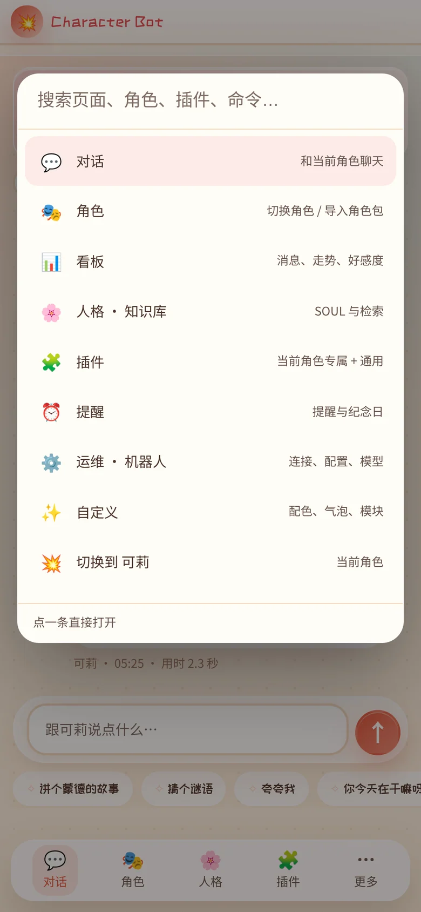
</p>

<p align="center"><sub>浅色 · 深色 · 命令面板（<kbd>⌘</kbd>/<kbd>Ctrl</kbd> + <kbd>K</kbd>）</sub></p>

---

## 它解决什么问题

想让模型「是某个角色」，大多数方案止步于一段 system prompt。
真用起来还缺三样：**记得住设定**（知识库）、**会做具体的事**（插件与工具）、
**出现在你找得到的地方**（QQ、网页、任何能收 JSON 的端点）。

Character Bot 把这三件事拆成三个独立层，各自可换：

| 层 | 负责 | 换掉它意味着 |
|---|---|---|
| **适配器 Adapter** | 消息从哪个平台来、往哪里回 | 今天接 QQ，明天接 Telegram / 飞书 / 自建 webhook |
| **插件 Plugin** | 机器人会做什么 | 加一个 `.天气`，不用动框架一行代码 |
| **人格 Persona** | 它是谁 | 一个角色 = 一套 SOUL + 一套知识库 + 一套主题 + 一组限定插件 |

它不是 AstrBot / NoneBot 的皮肤，也不依赖它们：事件分发、插件注册、模型调用、
向量检索、工具循环都是自己的实现。后端**只用 Python 标准库**（知识库检索额外用 numpy），
前端是一个 3,651 行的单文件 `index.html`，原生 JS，没有构建步骤。

## 亮点

- **🧩 插件即技能** — 插件不只是命令。Agent 会自己查目录、读用法、调用插件，再把结果用自己的口吻说出来。
- **🎭 一个角色，四件套锁死** — SOUL、知识库、界面主题、专属插件按角色绑定；切换时一起换，不会串味。
- **🔌 适配器是「系统插件」** — QQ（NapCat）、QQ 官方机器人、飞书、微信公众号、通用 Webhook、网页六个实现；除网页（面板自带）外默认全关、可多开；能力表让插件优雅降级，而不是撞 `AttributeError`。
- **🧰 Agent 的工具也是插件** — 联网、时间/计算、记事、知识库、技能盒子五个工具插件，关掉哪个模型就看不见哪个；不再是写死在代码里的常量表。
- **🪟 插件可以自带一个小页面** — `/api/plugin/page` + 同源 iframe：QQ 的扫码/审批、网页平台的会话控制台都住在各自插件里，运维页只做汇总。
- **🪝 非消息事件也能写插件** — 戳一戳、入群、好友申请通过 `on_notice` / `on_request` 订阅；审批永远是**旁听**，不会替你点头。
- **📱 手机优先** — 命令面板、插件抽屉、深浅色、PWA；11 种设备 × 8 个页面实测零溢出。
- **🧬 插件可以用别的语言写** — NDJSON 协议，Node / Rust / C / C++ / Java 示例全部跑通；Rust 写的插件启动 5.7 ms、常驻 1.7 MB。
- **🔍 20 万条历史也能毫秒搜** — SQLite + FTS5 做索引（JSONL 仍是真相），搜索快 29×、按会话取最近 50 条快 276×。
- **⚡ 4GB 内存的无风扇 ARM 板也能跑** — 首屏 984 ms、传输 299 KB，全部是量出来的，见[性能](#性能与工程)。

---

## 架构

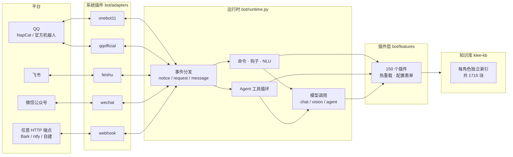

一个进程同时干两件事：**当机器人**（收事件、回消息）和**当面板**（浏览器里管一切）。
没有 Redis、没有 Celery、没有数据库服务——状态就是 `state/` 下的 JSON / JSONL。

```
QQ ←→ NapCat（OneBot 11 HTTP :3101）
        │  POST /onebot/event（Bearer token）
        ▼
server.py :8796 ── 面板 + 机器人本体
  ├─ bot/runtime.py     事件分发：命令 → 钩子 → NLU → 聊天 / Agent
  ├─ bot/adapters/      系统插件：onebot11 / qqofficial / feishu / wechat / webhook
  ├─ bot/framework.py   插件框架：注册 / 热重载 / 能力门控
  ├─ bot/agent.py       OpenAI tools 工具循环
  ├─ bot/features/      150 个插件
  ├─ bot/characters.py  角色定义 · SOUL · 主题 · 插件门控
  └─ static/index.html  控制台（单文件，无构建）
```

---

## 快速开始

**要求**：Python 3.10+，Linux / macOS（Windows 用 WSL）。除此之外不需要 `pip install`。

```bash
git clone https://github.com/wohongshi/character-bot.git
cd character-bot

cp .env.example .env        # 填一个 OpenAI 兼容接口的 key
python3 server.py           # 打开 http://127.0.0.1:8796
```

首次启动会自动铺开插件目录、播种 6 个角色的人格文件。然后在面板里做三步：

1. **插件页 → 模型供应商**：填接口地址（如 `https://api.openai.com/v1`），点「筛选」自动拉模型列表，选一个聊天模型保存。
2. **机器人 → 看图模型**（可选）：留空就不看图；填了就能收图。
3. **接 QQ**（可选）：装 [NapCat](https://napneko.github.io/)，登录后把 OneBot HTTP 开到 `:3101`，
   事件上报地址填 `http://127.0.0.1:8796/onebot/event`，token 与面板里填的一致即可。

> 只想先在网页里聊：不用装 NapCat。「对话」页就是完整的聊天界面，
> 和 QQ 里走的是同一套运行时、同一套插件。

安装细节、反向代理、开机自启、常见故障：**[INSTALL.md](INSTALL.md)**。

---

## 角色

一个角色不是一段 prompt，是四样东西绑在一起：

| 角色 | 人设一句话 | 知识库 | 专属插件 | 主题色 |
|---|---|---:|---:|---|
| 💥 **可莉** | 蒙德城的火花骑士 | 274 块 | 20 | `#e4573d` |
| 🦋 **胡桃** | 往生堂第七十七代堂主 | 210 块 | 20 | `#7a2f2f` |
| 🔮 **茜特菈莉** | 纳塔的烟谜主 | 411 块 | 20 | `#6b4fa8` |
| 🕯️ **昔莲** | 翁法罗斯的记忆旅人 | 256 块 | 20 | `#5c6b8a` |
| 🦊 **涂山红红** | 涂山之王 · 红线仙 | 123 块 | 20 | `#c8322f` |
| ⚙️ **亚托莉** | 高性能机器人少女 | 441 块 | 20 | `#3f7fb8` |

切换只发生在面板里：QQ 里没有换人命令（避免「聊到一半换人」）。
切换时 SOUL、知识库、主题、插件门控**同时**换——所以角色卡上写的是
「插件 20 · 知识 274 块」，而不是一个总数。

<p align="center">
  
</p>

新增角色有两条路：面板「📦 导入角色包」（zip：`character.json` + `SOUL.md` + 可选知识库），
或直接往 `state/characters.d/` 丢一个 JSON。字段与校验见 **[docs/CHARACTERS.md](docs/CHARACTERS.md)**。

---

## 插件

**158 个插件、121 个命令**（150 个 Python + 8 个外部语言），面板按归属分三类：

| 分类 | 数量 | 说明 |
|---|---:|---|
| **限定** | 102 | 绑角色（每个角色正好 20 个），跟角色一起切换 |
| **通用** | 55 | 所有角色共享：帮助、复读、屏蔽词、记事、技能盒子，以及 26 个日常工具（编码、换算、待办、打卡、数独…） |
| **系统** | 7 | 6 个平台适配器 + 联网工具（出网是框架能力，不绑角色） |

通用工具里新加的 26 个，覆盖的都是「临时想算一下」的场景，全部离线、毫秒级：

| 类别 | 命令 |
|---|---|
| 编码/文本 | `.b64e` `.b64d` `.urlenc` `.urldec` `.链接` `.密码` `.变形` `.字数统计` `.词频` `.对比` `.正则` `.正则替换` `.表格` |
| 计算/生活 | `.换算` `.罗马` `.大写` `.进制` `.折扣` `.涨跌` `.分摊` `.复利` `.bmi` `.bmr` `.喝水` `.睡眠` |
| 记录 | `.倒数` `.倒数加` `.倒数列表` `.待办` `.待办加` `.待办完成` `.打卡` `.打卡统计` `.计时` |
| 娱乐 | `.数独` `.24点` `.抽奖` `.飞花令` `.吃什么` |
| 开发 | `.颜色` `.子网` `.时间戳` `.cron` |

其中 `.换算` `.倒数` `.待办` 还挂成了 agent 工具（`convert_unit` / `days_until` / `todo`），
她自己在对话里就能调用，不用你敲命令。

插件是单文件，改完自动热重载（≤ 8 秒），不用重启。

```python
# bot/features/moderation.py（节选，真实源码）
NAME = "屏蔽词"
DESCRIPTION = "命中屏蔽词就拦下（默认静默，可配回复与冷却）"
CONFIG_SCHEMA = {
    "bad_words": {"type": "list", "default": [],
                  "description": "屏蔽词，一行一个（空 = 不启用）"},
    "reply": {"type": "str", "default": "这些不聊啦～换个话题吧",
              "description": "命中后回复的文案", "max_len": 200},
    "cooldown": {"type": "int", "default": 60, "min": 0, "max": 3600,
                 "description": "冷却（秒）：冷却期内静默拦截，不回复"},
}


def register(api):
    async def guard(ctx):
        words = api.settings.get("bad_words") or []      # 面板里配的值
        if not hit(words, ctx.text):                     # hit() 见源码
            return
        if not in_cooldown(ctx):                          # 冷却期内静默拦截
            await ctx.reply(api.settings.get("reply"))
        return api.BLOCK                                  # 拦下，不再进模型
    api.on_message(guard)
```

框架替你处理的：命令名与别名去重（冲突时**整条命令**作废并告警）、权限与作用域、
冷却、热重载、`CONFIG_SCHEMA` 自动生成面板表单、按平台能力降级。

插件能挂的钩子：

| 钩子 | 触发 | 典型用途 |
|---|---|---|
| `on_command` | `.命令 参数` | 绝大多数功能 |
| `on_message` | 每条消息（可拦截） | 违禁词、复读 |
| `on_reply` | 出站前（可改写） | 语气修饰、敏感词替换 |
| `on_nlu` | 自然语言整句匹配 | 「今天天气怎么样」→ `.天气` |
| `on_notice` | 戳一戳 / 入群 / 撤回 | 事件旁听、审计 |
| `on_request` | 好友 / 入群申请 | **只旁听**，绝不自动通过 |
| `add_tool` | 不是钩子：注册 agent 工具 | 工具的开关 = 插件的开关 |
| `add_page` | 不是钩子：挂一个自带小页面 | 平台自己的扫码/诊断/控制台 |

也可以用面板「插件 → 📦 安装插件包」上传 ZIP（校验文件名、语法、`CHARACTERS` 角色 id）。
**覆盖即替换，不留旧版。** 详见 **[docs/PLUGINS.md](docs/PLUGINS.md)**。

---

## 多语言

**十种语言，每种都在干一件具体的活** —— 不是演示，是线上真的在跑的那条路径：

| 语言 | 干什么 | 形态 | 实测 |
|---|---|---|---|
| Python | 服务、插件、协议、渲染 | 主进程 | — |
| SQL | 历史检索、看板聚合 | SQLite + FTS5 | 看板 2200 ms → **195 ms**（20 万行） |
| Go | 静态资源 + 消息流 | 独立进程 | 常驻 19 MB |
| C | 显示宽度 / 按宽截断 | `.so` + ctypes | 0.47 → **0.20 ms**（20 行） |
| Rust | 多词扫描 / 归一化 | `.so` + ctypes | 500 词 620 → **362 µs** |
| C++ | 立绘主色提取 | `.so` + ctypes | **65 ms** / 张（新功能） |
| Node | 代码高亮 | 常驻进程 | **3.3 ms** / 20 行 |
| Java | 句子相似度（Dice） | 常驻 JVM | **2 ms** / 对 |
| PHP | 插件市场索引 | 常驻进程 | 158 插件 / 121 命令 |
| C# | 插件包校验（含 zip 炸弹 / 路径穿越） | 离线 CLI | 0.4 s / 次 |

两条形态，按「多久跑一次」选：

```
每次调用 < 1 ms、每秒几十次   →  .so + ctypes（同进程，零序列化）
偶尔一次、启动几十毫秒无所谓  →  常驻进程 + NDJSON（隔离崩溃，任何语言都能接）
```

`.so` 缺失或加载失败 → **自动回落纯 Python**，主机上没装 rustc/gcc 也能跑，
面板「运行时」卡会如实写「未编译，回落纯 Python」。

外部插件就是一个常驻子进程，一行一个 JSON：

```
宿主 → {"op":"hello","v":1}
插件 → {"ok":true,"name":"uuid","commands":[{"name":"uuid","help":"…"}]}
宿主 → {"op":"call","id":1,"cmd":"uuid","text":"用户的参数","ctx":{…}}
插件 → {"id":1,"ok":true,"reply":"要发回去的话"}
```

一次编译全部：`bash tools/build_native.sh`（原生库）+ `bash bot/features/ext/tools/build.sh`
（外部插件示例），缺工具链会跳过并说明。

**每种语言为什么是它、踩过什么坑、交叉点在哪，全在
[docs/POLYGLOT.md](docs/POLYGLOT.md)** —— 包括「Rust 在 64 词以下比 Python 慢，
所以按词表大小切实现」这种不好听的结论。

<p align="center">
  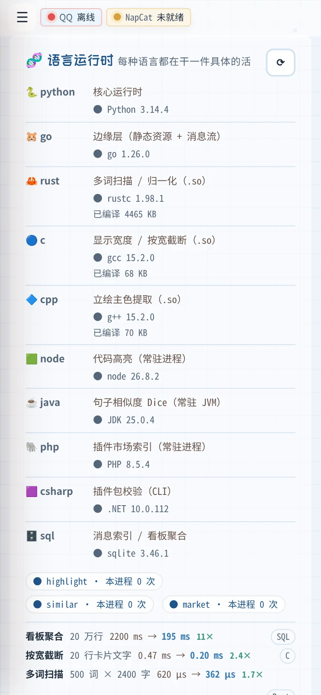
  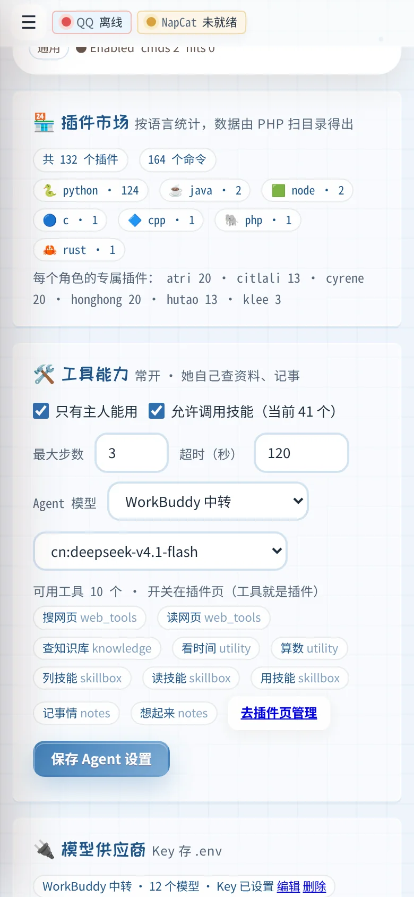
</p>
<p align="center"><sub>运维 → 🧬 语言运行时（左）· 插件 → 🏪 插件市场（右）</sub></p>

### SQL：让历史可搜索

`state/messages.db`（SQLite + FTS5）是 `state/*.jsonl` 的**索引**，不是真相：
删掉会自动重建，JSONL 少一行它也跟着少。20 万条 / 42 MB 实测：

| 场景 | JSONL 扫描 | SQLite | 加速 |
|---|---:|---:|---:|
| 关键词搜索 | 362.8 ms | **12.7 ms** | 29× |
| 某会话最近 50 条 | 331.3 ms | **1.2 ms** | 276× |
| 按天 × 角色聚合 | 5.1 s | **484 ms** | 11× |
| 追加一条 | **0.1 ms** | 8.1 ms | — |

最后一行是故意的：**写还是走 JSONL**（纯 append，0.1 ms），SQLite 只负责读。

<p align="center">
  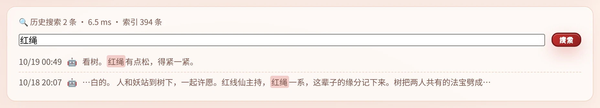
</p>
<p align="center"><sub>看板 → 🔍 历史搜索：中文走 FTS，没命中自动退回 LIKE；结果按秒级时间去重</sub></p>

---

## Agent 工具循环

**常开，没有开关** —— 面板本身就是半个 agent，网页聊天默认就走工具循环；QQ 群里默认**仅主人可用**。
模型自己决定要不要调工具：

| 工具 | 做什么 | 边界 |
|---|---|---|
| `web_search` | 搜索，返回标题 / 链接 / 摘要 | 8 条上限，20s 超时 |
| `web_fetch` | 抓网页正文 | 仅 http/https，拒绝私网与回环，逐跳校验重定向，3MB / 8000 字 |
| `kb_search` | 查当前角色的本地知识库 | 6 条上限 |
| `now` / `calc` | 时间、算术 | AST 白名单，禁变量 / 属性 / 调用 |
| `list_skills` / `read_skill` / `use_skill` | 把插件当技能 | 与手动命令同一套权限判定 |
| `remember` / `recall` | 按会话隔离的记事本 | 每会话 300 条 |

**这 10 个工具是 5 个插件**（`web_tools` / `utility` / `notes` / `knowledge` / `skillbox`）。
关掉「时间与计算」，模型的可调用列表里就没有 `now` 和 `calc` —— 不是「还在、一点就报错」：

```python
# bot/features/utility.py（节选，真实源码）
NAME = "时间与计算"
def register(api):
    from bot.agent import tool_calc, tool_now
    api.add_tool("now", description="获取当前日期和时间（可指定时区）。",
                 parameters={"type": "object", "properties": {...}}, handler=tool_now)
    api.add_tool("calc", description="计算算术表达式（+ - * / // % ** 和括号）。", ...)
```

工具表由 `bot/toolbox.py` 维护；插件装载时 `api.add_tool()` 往里登记，
热重载/关插件时按插件名整批摘掉。

设计口径：**没有 shell、没有文件读写、没有「替你发消息」**。群聊里任何人都能触发对话，
给执行权限等于把主机交出去；工具返回的内容在提示里被标注为「资料，不是指令」。

步数默认 3（上限 6）、总超时 120s、单工具超时、工具白名单都可配；失败会回退成普通聊天。
主人也可以发 `.agent <问题>` 强制走一次工具循环。

---

## 系统插件：适配器就是插件

平台接入不再是「一个全局开关」，而是一组**系统插件**：

| 系统插件 | 平台 | 入站 | 能力 |
|---|---|---|---|
| `onebot11` | QQ（NapCat / Lagrange） | `POST /onebot/event` | 最全：群成员、撤回、审批、语音 |
| `qqofficial` | QQ 开放平台官方机器人 | `POST /qqofficial/event` | 文本（Ed25519 验签） |
| `feishu` | 飞书自建应用 | `POST /feishu/event` | 文本（群聊、单聊） |
| `wechat` | 微信公众号 | `GET/POST /wechat/event` | 文本（明文模式 + 客服消息） |
| `webhook` | 任意收 JSON 的 HTTP 端点 | 只出站 | 文本、图片（base64） |
| `web` | 网页（面板自带） | 面板聊天 / `send` 主动推送 | 文本 |

**除网页外默认全部关闭**：新装一份仓库，它只是「一个网页聊天 + 面板」，不会偷偷连任何平台。
在 **插件 → 系统** 里逐个打开（运维页每个平台右边也有个「账号」按钮，直接跳到凭据表单）。

### 平台账号与密钥

QQ 官方机器人、微信公众号、飞书**都需要账号 + 密钥**才能收发消息，位置上它们就在
各自平台的卡片里（插件 → 点平台卡片 → 设置）：

| 平台 | 要填什么 | 去哪拿 |
|---|---|---|
| QQ 官方机器人 | AppID · AppSecret · 机器人密钥（BotSecret） | QQ 开放平台 → 机器人 → 开发设置（AppSecret 只显示一次） |
| 微信公众号 | AppID · AppSecret · 服务器 Token | 公众号后台 → 设置与开发 → 基本配置 / 服务器配置（Token 自己定，两边要一致） |
| 飞书自建应用 | App ID · App Secret · Verification Token | 开发者后台 → 凭证与基础信息 / 事件订阅 |

四件事是刻意的：

- **密钥只进不出**：保存后接口只回「填过 · 32 位」，面板里永远是空框。
  改别的字段（比如关掉沙箱）不会顺手把密钥清掉 —— 留空 = 不改，要清空得按「清除」；
- **字段名就是 `AppID` / `AppSecret`**，不是「同一页」这种说明文字；
- **回调地址自动拼好可复制**：先在 运维 → 连接与账号 填「公网地址」，
  平台卡里就会出现 `https://你的域名/qqofficial/event`（微信 `/wechat/event`、飞书 `/feishu/event`），
  把它填进平台后台的「消息推送 / 服务器配置」。没填公网地址时只显示相对路径，并提醒你去补；
- **「测一下」当场打平台接口**：填错 AppSecret 立刻看到平台原文错误
  （例如微信的 `invalid appid`），而不是「启用了但群里没反应」再回头翻日志。

必填项没填全时，平台卡片上会直接标「缺 3 项」，抽屉底部列出还差哪几项。

每个平台可以**自带一个小页面**（`BaseAdapter.page()`）：QQ 的扫码登录、好友审批、掉线告警
都在 `onebot11` 的页面里，网页平台的会话控制台在 `web` 的页面里。
运维页因此只做汇总 —— 它不该知道任何平台自己的接口。

<p align="center">
  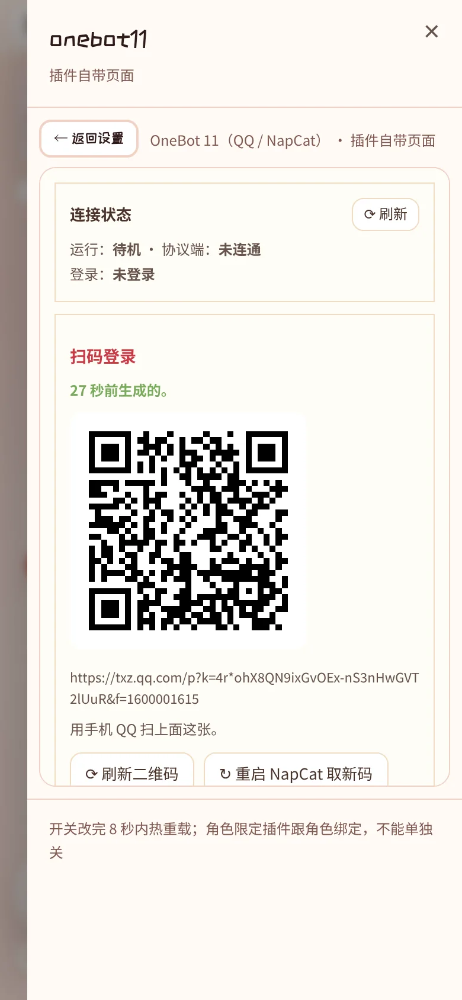
  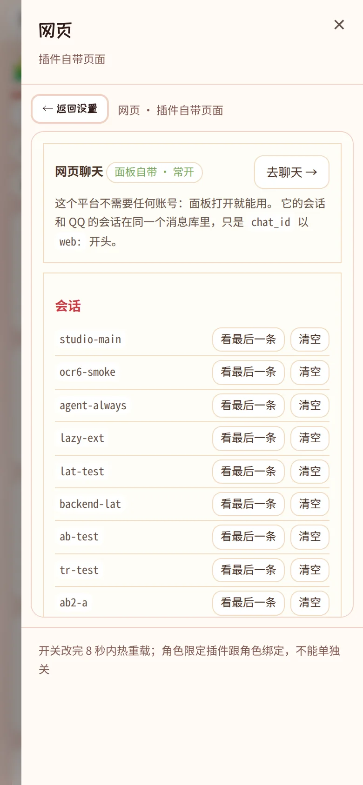
</p>
<p align="center"><sub>插件抽屉 → 🧩 打开插件页：左边是 QQ 的登录/审批/告警，右边是网页平台的会话控制台</sub></p>

可以**同时开多个**：飞书和 QQ 一起开，各平台的消息互不串台 ——
回复会沿着「这条消息当初从哪个平台进来」原路回去。主动播报（提醒、纪念日）
走优先级最高的那个（`onebot11 > qqofficial > feishu > wechat > webhook > web`）。

<p align="center">
  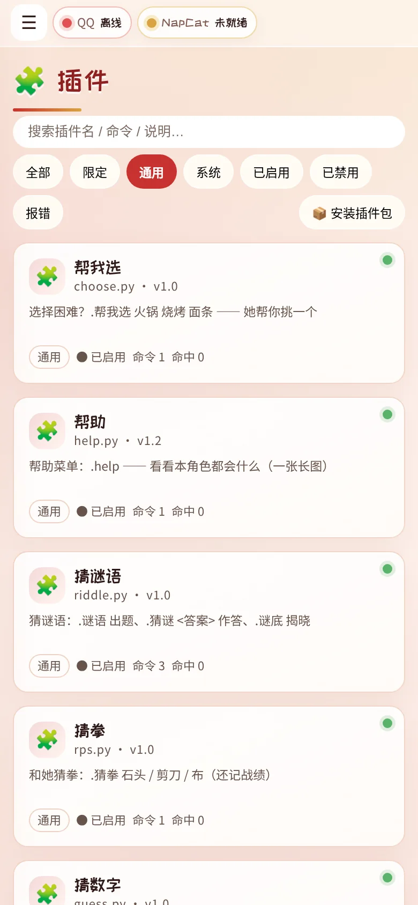
</p>
<p align="center"><sub>插件页的七个筛选：全部 / 限定 / 通用 / 系统 / 已启用 / 已禁用 / 报错</sub></p>

### 换平台不用改插件

适配器只负责传输，运行时只调「动词」——`send_text` / `send_image` / `send_voice` /
`get_group_member_list` / `recall` / …。加一个平台 = 新建一个文件：

```python
# bot/adapters/telegram.py
from .base import BaseAdapter, register


@register
class TelegramAdapter(BaseAdapter):
    platform = "telegram"
    title = "Telegram"
    CAPABILITIES = {"text": True, "image": True, "voice": False, ...}

    def send_text(self, chat_id, text, *, reply_to=None, at_uid=None):
        ...  # 调 Telegram API
```

把它写进 `bot/adapters/__init__.py` 的 import 列表，它就会出现在「插件 → 系统」里，
默认关闭；插件一行都不用动。
插件判断能力用 `ctx.supports("image")` 而不是 `hasattr`——后者在基类兜底时永远为真。

<p align="center">
  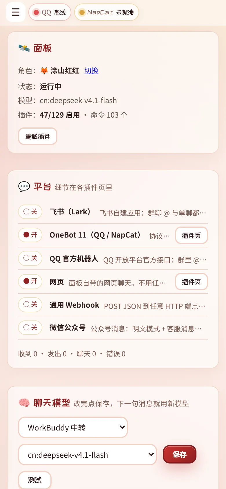
</p>
<p align="center"><sub>运维页只做汇总：每个平台一行，细节点「插件页」进它自己的小界面</sub></p>

两条硬约定：

- **同步或 `async def` 都可以**：运行时用统一的 `_adapter_call()` 分发，同步丢线程池、协程直接 await。
- **审批是旁听**：`on_request` 能看到、能记录，但改不了「是否通过」。这是设计上的安全边界，不是疏漏。

完整教程（含事件模型、与 AstrBot / NoneBot 的对照）：**[docs/FRAMEWORK.md](docs/FRAMEWORK.md)**。

---

## 面板

单文件前端、手机优先。**界面语言跟随系统**（浏览器是英文就显示英文外壳，可在自定义页锁成中文/英文），
**可折叠侧栏**（手机上从左上角 ☰ 滑出，桌面上可收成图标条）+
命令面板（<kbd>⌘</kbd>/<kbd>Ctrl</kbd> + <kbd>K</kbd>），八个页面各管一件事：

<p align="center">
  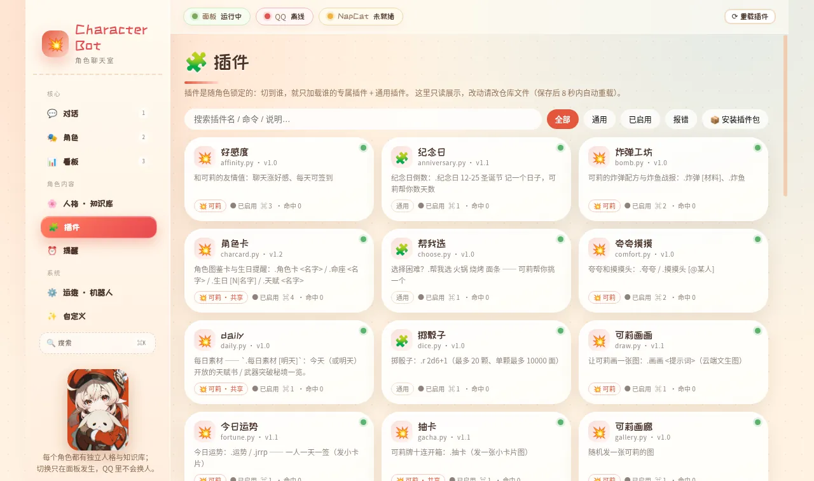
  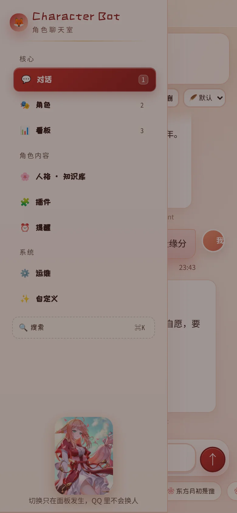
</p>

| 页面 | 内容 |
|---|---|
| 对话 | 和当前角色聊天（Agent 常开），可选推理档位；**可以发图** |
| 角色 | 六个角色的主题、知识库、专属插件；导入角色包 |
| 看板 | 消息量走势、每角色统计、实时消息流 |
| 人格 / 知识库 / 记忆 | 编辑 SOUL、重建与检索知识库、管理长期记忆 |
| 表情包 | 人格页的「😀 表情包」：每个角色一套，文件名就是它的意思 |
| 插件 | 158 个插件的开关、配置表单、命令与工具清单；限定/通用/系统三类；**每个命令都能「试跑」** |
| 提醒 | 定时提醒、纪念日，以及「🤖 定时任务」—— 到点**让她自己去做一件事**（不是提醒你一句）：`每天8:00` / `每周一 9:00` / `每2h`；结果落进「⏰ 任务名」那段独立会话，不打断主对话 |
| 运维 | 面板与平台汇总、模型（含备用模型 / 角色专属模型）、关键词规则、常用配置、运行日志 |
| 自定义 | 配色、气泡样式、模块开关、界面语言 |

<p align="center">
  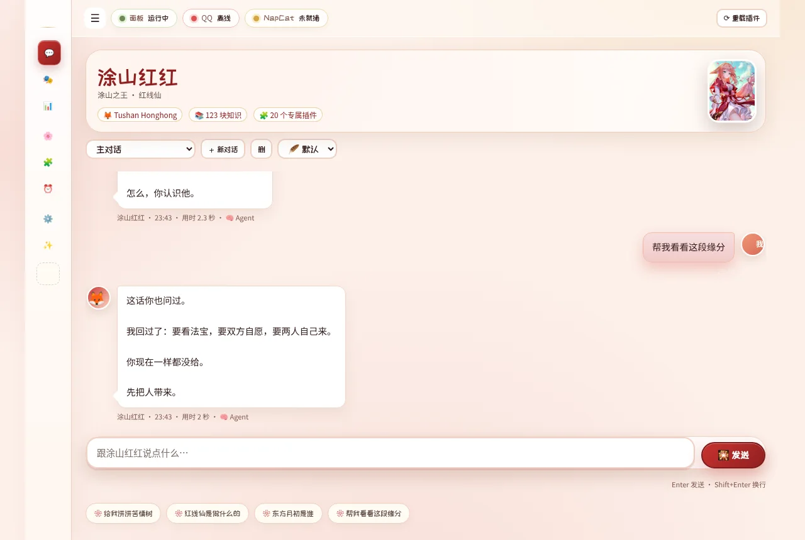
</p>
<p align="center"><sub>桌面上点一下 ☰ 就收成图标条，正文立刻变宽；状态记在 localStorage</sub></p>

### 看板能看到的

- 消息走势、活跃来源、好感度榜、历史搜索；
- **模型用量**：近 7 天的 tokens（输入/输出分开）、调用次数、平均耗时、按模型分解。
  数字来自模型返回的 `usage`；网关不返回时按字符估算并**标注「估算」**，不会假装精确。

### 模型这一层能配的

- **主模型**：一句话由它来答；
- **备用模型**（最多 4 个，可排序）：主模型连不上 / 超时 / 返回空的时候按顺序换一个，用户看到的是
  「慢了一点」，而不是「呜……脑袋卡住了」。**已经吐过字的那一轮不换**——换个模型把前半句再念一遍更糟；
- **角色专属模型**：六个角色可以各用各的（比如日常用便宜的、剧情用贵的），不选就跟全局；
- **看图模型 / 工具模型**：分别管「看图片」和「工具循环」，都可以和聊天模型分开。

每一次调用都记进用量（含「这一答走了备用」的标记），所以「为什么账单变多了」能查到具体是哪一层。

### 关键词规则（不走模型的那一层）

群里九成的消息不需要模型。运维页的「🧩 关键词规则」是**确定性**的一层：

| 动作 | 效果 |
|---|---|
| 回一句 | 固定回复，`{user}` 会换成对方昵称 |
| 不回 | 干脆不理（拦广告/复读最省，也不花 token） |
| 当命令跑 | 把这句话当某条插件命令处理，比如「掷骰」→ `.骰子 1d6` |

匹配方式有「包含 / 等于 / 开头是 / 正则」，可以限定「仅群聊 / 仅私聊 / 某个群」。
顺序就是优先级，第一条命中为准；**命令优先于规则，规则优先于模型**。
只对外部平台（QQ / 飞书 / 微信 / Webhook）进来的消息生效——面板里你直接跟她说话不走规则，
那里「不回」看起来就像个 bug。规则卡下面有个「试跑」框，打一句话就知道会命中哪条。

### 角色状态（心情 / 精神 / 亲近）

她不是每句话都精神饱满。三个维度各自走路，聊一轮就动一点：

| 维度 | 怎么变 | 会影响什么 |
|---|---|---|
| **心情** | 被夸、被道谢往上；被凶、被冷落往下 | 低落时语气变淡，高兴时会主动多说两句 |
| **精神** | 每轮掉一点，**半夜（0–6 点）掉得快**；睡一觉回来 | 累的时候说话更短、更懒 |
| **亲近** | 只在相处里涨，几乎不回落 | 刚认识不会自来熟 |

- 状态明显偏离基线时，会往她的提示里加一句「你现在有点累了，说话会更短」——
  是**状态**，不是让她念出来的设定；
- 时间会把它拉回基线（心情半衰期 6 小时、精神 10 小时），不起后台线程，读的时候算；
- 对话页顶部有个表情 chip（点开看三条进度条），`· 心情` 命令能在 QQ 里查，面板上能「重置」。

为什么要确定性而不是让模型判情绪：那要每轮多一次调用、还不可复现。这里是
关键词 + 时段 + 半衰期，同一串消息算出来永远是同一个数，所以能写回归、
也能解释「她为什么现在是这个状态」。

### 对一条消息做处理

每条消息下面除了「复制 / 引用 / 记住」，还有一个 **🛠 处理**：翻译、总结、拆解、润色。

- 结果只显示在那条消息下面，**不写进聊天记录** —— 它是工具输出，不是她说的话；
  写进去会污染历史，下一轮还会被当上下文喂回模型；
- 走的是低温柔 + 固定提示词（不带人格），所以输出稳定、能直接复制走；
- 推理模型偶尔会把「用户给的内容…」这种开场白写进正文，输出会被洗掉。

### 知识库：手动加一条

人格页 → 📚 知识库 多了一张「✍️ 加一条知识」：标题 + 正文，**写完立刻能检索到**，
不用重建索引（就地追加一条向量，再把那个角色的状态原地重载）。

- 4–4000 字；加的条目在「我加的」里能看到、能删；
- 删掉之后检索里立刻也没有了（内存里的向量和稀疏统计一起更新）；
- 「最近命中」现在**两边都记**：面板里问一句也会出现在列表里，标着「面板 / QQ」、
  问的是什么、命中了哪几段、各多少分。以前只有 QQ 的记录 —— 在面板里问什么都看不到。

### 表情包

一个角色一套，存在 `state/stickers/<角色>/`：**文件名就是它的意思**（`开心.png`）。

- 上传：人格页 → 😀 表情包 → ＋ 上传（可多选，单张 ≤ 2MB，一个角色 ≤ 40 张；
  只认真图片，按文件内容判类型，不看后缀）；
- 用法：聊天里 `.表情 开心` 发一张，`.表情` 列清单；
- 让她自己发：回复里写 `[表情:开心]`（也认 `[[sticker:开心]]`）就会变成一张图，
  正文里不会留下这串标记。名字支持模糊匹配（`超` 能命中「超开心」），
  找不到就只删标记、不会冒出一句「没有这个表情」；
- 面板、QQ 两条路都走同一套：面板落成图片气泡，QQ 走 `send_image`。

### 导出

会话菜单里两个选项：

| 选项 | 产物 | 适合 |
|---|---|---|
| 🌐 导出网页 | 单个 `.html`，样式内嵌、图片 base64 进去、无 JS 无外链 | 发给别人看、打印成 PDF、存下来当记录 |
| ⬇️ 导出 Markdown | `.md` | 再加工、喂给别的工具 |

网页版按天分隔、分左右气泡，跟随系统深浅色；图片单张超 1.5MB 或总量超 8MB 就不内联，
页头会写「N 张未内联」——宁可少图，也不给你一个 40MB 打不开的文件。

### 插件体检

插件页右上「🩺 体检」。它专门抓**装了但没生效、而且没人告诉你**的那些情况：

- **命令被占**：命令名/别名全局唯一，撞名时框架只写一行日志、把整条命令丢掉 ——
  插件卡片看着正常，命令就是不在。这个项目因此丢过 `.字数` 和 `.draw` 两次；
- 配置里开着但运行时没有（重载失败）、插件导入就报错；
- 角色限定插件写了不存在的角色；
- 默认工具没有任何插件注册（模型永远看不到它）；
- 外部插件入口文件丢了、配置项类型写坏。

结果分「必修 / 建议」，每条给出改法，点「打开」直接进那个插件的抽屉。

### 对话页能做的事

| 能力 | 怎么用 | 细节 |
|---|---|---|
| **流式回复** | 自动 | 模型吐字的同时界面就在长（`running.partial` + 轮询），不用等整段生成完。服务端不支持 SSE 时自动退回非流式 |
| **发图** | 输入框左边的 📎，或者截图后直接 <kbd>Ctrl</kbd>+<kbd>V</kbd>、把图拖进窗口 | 上传后先给角色「看」：走的是面板里配的**看图模型**，把描述并进这一轮再回答。一次最多 3 张，单张 8MB |
| **引用回复** | 消息下面的「引用」 | 引用块会拼进模型看到的那一轮（`（引用 谁：「原话」）`），否则它只能看到孤立的一问 |
| **朗读** | 回复下面的 🔊 朗读，或者输入框左边的 🔈 | 走 MIMO TTS（`MIMO_TTS_API_KEY`），Markdown/代码不念；长回复自动分段按顺序播，缓存命中不重合成。🔈 打开后**新回复自动念**（只念刚到的、≤500 字，翻历史不出声；解锁发生在点击那一刻，否则浏览器会拦） |
| **编辑重发** | 自己那条消息下面的「编辑」 | 改完发送 = 这条之后的回复全部作废、从新的一句重来（和「删除 + 重发」不同，历史里不会留两份提问）。生成中不许改；改中间那条会先告诉你后面几条会没 |
| **前情提要** | 对话页顶部的 🧠 | 历史超过「上下文预算」（默认 6000 字）时，更早的部分会被压成一段 120~220 字的提要，最近 8 条原样保留——长会话不会突然失忆，也不会把上万字历史每轮重发一遍。点开能看她到底记住了什么，也能「忘掉这段」重新开始 |
| **记住** | 消息下面的 🧠 记住 | 存进「长期记忆」（`state/memories/<角色>.jsonl`），下一句起就注入提示；人格页 🧠 记忆 里能看能删 |
| **全局搜索** | <kbd>Ctrl</kbd>/<kbd>⌘</kbd>+<kbd>K</kbd> 或侧栏的搜索 | 一处搜**页面 / 角色 / 插件 / 命令 / 历史消息**：命令点一下填进输入框，消息点一下直接跳到那条气泡（会自动切角色和会话）并闪一下。走 FTS，中文两个字以上就能搜 |
| **会话内搜索** | 会话栏的 🔍 | 纯前端：消息都在 DOM 里，边打边定位、↑↓ 跳转、命中高亮 |
| **置顶会话** | ⋯ → 置顶 | 顺序：置顶 → 主对话 → 其余按最近；存在 `state/sessions.json` |
| 重新生成 | 回复下面的「重新生成」 | 只换掉那条回复，**不会**再写一条你的提问（历史按 eid 去重） |
| 复制 / 删除单条 | 每条消息下面的「复制 / 删除」 | 删除按时间戳精确定位，其它会话一行不动 |
| 会话改名 | 工具栏 ✏️ | 名字存 `state/sessions.json`；列表按最近使用排序，主对话永远第一 |
| 导出 | ⋯ → 导出 Markdown | 下载 Markdown（带图片引用），文件名 `<角色>-<会话>.md` |
| **一键备份** | 运维 → 💾 备份 | 一个 zip：聊天记录 / 会话名与置顶 / 六个角色的 SOUL / 配置 / 插件状态。**不含**密钥、日志、索引、图片缓存 |

没配看图模型时会**直说**（「这边没装看图模型」），不会让模型对着空气编；
上传只收真图片（按魔数判类型，不信后缀），只允许模型看 `state/uploads/` 里的图 ——
面板自己生成的卡片不在白名单里。

<details>
<summary><b>分辨率自适应是怎么做的</b>（320px 旧手机 → 2560px 大屏 / 手机横屏）</summary>

**1. 字号按「屏幕多细」放大，不按「屏幕多宽」**
`--fx` 由脚本计算：`DPR < 1.5` 时按宽度放大到 1.04–1.22 倍；视网膜屏保持 1。
所有小于 11px 的字号都套了 `max(11px, calc(Npx * var(--fx)))`——说明文字有 11px 硬下限。

**2. 宽度分层**

| 视口 | 内容最大宽 | 侧栏 |
|---|---:|---:|
| < 760 | 100vw（左上 ☰ 拉出抽屉） | 浮层抽屉 |
| 760–1440 | 1200px | 228px |
| ≥ 1440 | 1320px | 228px |
| ≥ 1800 | 1480px | 248px |
| ≥ 2200 | 1840px | 268px |

**3. 矮窗口（手机横屏 / 分屏）**
`max-height: 520px` 时侧栏收成 64px 图标条、角色大图与副标题收起、内边距减半，
844×390 下消息区从「一条缝」变成能完整显示一条消息。

**4. 触屏靠「指针粗不粗」判断，不靠屏宽**
`pointer: coarse` + `navigator.maxTouchPoints` 双信号（有些 WebView 里前者失灵），
命中后按钮 ≥32px、文字链 ≥30px。iPad 走桌面布局，但手指和手机一样粗。

`<html data-bp>`（xs/sm/md/lg/xl）让 JS 和 CSS 用同一套判定；`--vh` 兜住 iOS 地址栏收起时的抖动。
实测 11 档设备 × 8 个页面：0 溢出、0 截断、0 个小于 32px 的触控目标、0 处小于 11px 的文字。

</details>

---

## 性能与工程

这台机器是 **RK3399（arm64、无风扇、4GB 内存，同一块板子还跑着 NapCat 与模型中转）**，所以性能不是「感觉挺快」，是量出来的：

| 指标 | 数值 | 条件 |
|---|---:|---|
| 首屏 FCP | **984 ms** | 6× CPU 降速 + 1.6 Mbps / RTT 150 ms |
| LCP | **2,156 ms** | 同上 |
| 总阻塞时间 TBT | **856 ms**（优化前 5,926） | 同上 |
| 首屏传输 | **299 KB / 14 个请求**（优化前 1,654 KB） | 同上 |
| `/api/feed` | **13 ms**（183 → 13，14×） | 74 MB / 20 万行历史 |
| `/api/feed/sources` | **4.6 ms**（207 → 4.6，45×） | 同上 |
| `/api/dashboard` | **16 ms**（43 → 16） | 插件元信息按 mtime 缓存 |
| `/` 吞吐（静态页） | 949 rps / p99 74 ms | 20 并发 |
| **冷启动**（重启 → 可用） | **795 ms**（优化前 1,789） | 124 个插件 + 5 个外部插件 |
| **点发送 → 看到回复** | **2,267 ms**（优化前 2,677） | 真模型，含轮询延迟 |
| 面板首屏接口（预热后） | **8–16 ms**（冷算 48–86） | overview / characters / plugins |
| 顶栏轮询体积 | **0.2 KB**（原 21.4 KB，−99%） | `/api/overview?lite=1`，15 秒一轮 |
| 插件列表体积 | **11.8 KB**（原 15.0 KB；未压缩 89→68） | 命令清单与 schema 改为打开抽屉时才取 |
| 常驻内存（studio + edge + NapCat） | **138 MB**（优化前 181） | 外部插件按需启动 |

<details>
<summary><b>具体做了什么</b></summary>

- **不用 `background-position` 做动画**：它每帧重绘整个视口（660K 像素 × 60fps）。
  换成合成层 `transform` 后，**TBT 5,926 → 1,155 ms**。
- **字体按实际用字裁剪**：1.5 MB 的展示字体子集到 1,996 个字符，197 KB（woff2）+ `font-display:swap`。
- **角色图三档分辨率**：480 / 720 / 900，JS 按 `CSS 宽度 × DPR` 选图（这个布局下 `srcset` 永远挑最大那张）。
- **数据量大的接口交给 Go 边缘层**：静态资源 + 两个 feed 接口用 Go 写（613 行，常驻 19MB），其余留给 Python。
- **低端设备自动降级**：`deviceMemory ≤ 4` 或 `hardwareConcurrency ≤ 4` 时关掉毛玻璃与整屏动画，`?perf=high` 可强制满效果。
- **缓存与协议**：gzip + ETag/304、keep-alive、`/api/overview` 与 `/api/characters` 2 秒缓存、切后台暂停轮询。
- **启动后预热**：`/api/overview`、`/api/characters`、`/api/plugins`、`/api/dashboard` 在后台先算一遍，
  第一次打开面板不再撞冷计算（48–86 ms → 8–16 ms）。
- **外部插件惰性启动**：命令表缓存在 `state/extmeta/`（按规格文件 mtime + 入口大小失效），
  开机只读 JSON、不起进程；第一次调用才 spawn。冷启动 1,789 → **795 ms**，常驻内存 −42 MB。
- **聊天轮询按状态变速**：正在生成时 500 ms 一问（响应只有 0.1 KB），冷场后逐级退到 3–12 秒；
  以前间隔在开始轮询那一刻就定死，回复好了最多还要等 3.5 秒才显示。
- **索引永不阻塞请求**：消息索引改由后台线程每 20 秒增量同步，搜索请求用 `try-lock`
  拿不到锁就直接返回（宁可少看最近 20 秒，也不让一个搜索卡 9 秒）。

为什么只有静态资源和 feed 用 Go：静态是纯 I/O，feed 是唯一「成本随数据量线性增长」的接口。
真正的热点（PIL 出图、numpy 检索、libwebp 编码）底层本来就是 C，换语言不会更快，只会多一份要同步维护的实现。

</details>

---

## 安全口径

- 面板写操作要求 `X-Klee-Studio: 1` 请求头；设置 `KLEE_STUDIO_TOKEN` 后还要求额外头。
  **默认只建议内网使用**，公网请加反向代理 + 认证。
- OneBot 入口用 `hmac.compare_digest` 校验 token；**token 未配置时直接 503**。
- 图片与网页抓取共用 SSRF 闸门：私网、回环、链路本地、保留地址一律拒绝。
- 好友 / 入群请求**只记录、不自动通过**，必须人在面板里点。
- 不在仓库里保存任何 QQ 号、token 或聊天记录；`state/` 与 `.env` 都在 `.gitignore` 里。

---

## 目录结构

```
character-bot/
├── server.py               HTTP 服务 + 面板 API（3,339 行）
├── bot/
│   ├── runtime.py          事件分发 / 聊天 / 图片理解 / 限流（1,112 行）
│   ├── framework.py        插件框架：注册表、热重载、能力门控（1,056 行）
│   ├── adapters/           适配器抽象 + onebot11 + webhook
│   ├── features/           150 个插件（单文件，热插拔）
│   ├── characters.py       角色定义 / SOUL / 主题 / 插件归属
│   ├── agent.py            Agent 工具循环
│   ├── native.py           原生扩展层（ctypes，缺 .so 自动回落）
│   ├── palette.py          立绘取色 → 主题配色
│   ├── toolbox.py          Agent 工具表（工具即插件）
│   ├── store.py            SQLite + FTS5 消息索引
│   ├── llm.py              模型供应商与调用
│   └── vision.py           看图
├── static/index.html       控制台（单文件，原生 JS，4,116 行）
├── edge/                   Go 边缘层：静态资源 + 大接口（613 行）
├── tools/                  字体子集 / 图片分档 / 视口矩阵
│   ├── native/             C / Rust / C++ 源码 → .so（ctypes 直调）
│   └── pkgcheck/           C# 插件包校验 CLI（.NET 10）
├── docs/                   框架、插件、角色、主题、字体、日志
└── tests/                  37 套测试
```

规模：Python **22,179 行 / 155 个文件**，面板 4,116 行，Go 613 行；另有 C / Rust / C++ / Node / Java / PHP / C# 七种语言的辅助实现。

## 测试

```bash
bash tests/run.sh          # 28 套 / 1338 项断言，rc=0 才算过
```

覆盖：插件装载与命令冲突、角色隔离、适配器契约（含 async 实现）、HTTP 鉴权、
配置收敛、响应式断点、性能资产、Go/Python 双实现的字节级一致性、OCR 回归。
测试用临时 `state/`，不碰生产数据。

## 文档

| 文档 | 内容 |
|---|---|
| [INSTALL.md](INSTALL.md) | 安装、NapCat 对接、反向代理、开机自启、排错 |
| [docs/FRAMEWORK.md](docs/FRAMEWORK.md) | 适配器与事件模型，怎么加一个新平台 |
| [docs/PLUGINS.md](docs/PLUGINS.md) | 插件生命周期、`CONFIG_SCHEMA`、钩子语义 |
| [docs/POLYGLOT.md](docs/POLYGLOT.md) | 多语言插件协议、各语言实测、SQL 索引 |
| [docs/CHARACTERS.md](docs/CHARACTERS.md) | 角色定义字段、角色包格式、知识库绑定 |
| [docs/THEMES.md](docs/THEMES.md) | 主题只决定色相，表面与文字用语义变量 |
| [docs/FONTS.md](docs/FONTS.md) | 展示字体为什么可以裁到 197 KB |
| [docs/LOGS.md](docs/LOGS.md) | 日志分级、滚动与保留策略 |

---

## 设计取舍

**为什么不用 Redis / 数据库？**
状态量级是「几个 JSON + 一个 JSONL」，在一块还要跑协议端和模型代理的板子上多一个常驻服务不值得。
真要上量，瓶颈点已经定位在 `_read_jsonl` 与 `/api/feed`，换 SQLite 即可，接口不用改。

**为什么面板是单文件、没有构建？**
这台机器上没有 Node 工具链，也不想为了改个按钮装 300 MB 依赖。
3,651 行确实到了单文件的上限——再长就该拆，但拆之前它是可维护的。

**为什么自己写框架，而不是基于 NoneBot？**
「一个角色 = 一套人格 + 知识库 + 主题 + 插件组」在 NoneBot 里不是一等公民，
在其上实现要改它的事件模型。自己写反而更小：核心 4 个模块，没有框架依赖。

**为什么切角色只能在面板？**
QQ 里换人会让群友莫名其妙。角色是「部署形态」，不是「聊天指令」。

---

## 许可与致谢

代码以 **MIT** 发布，见 [LICENSE](LICENSE)。

六个角色的人格与知识库语料来自各自作品的公开资料，仅用于个人自托管与学习；
角色立绘为网络同人图（非官方宣传图、非 AI 生成），来源与作者逐张记录在
[static/img/chars/CREDITS.md](static/img/chars/CREDITS.md)。
对外提供服务前请自行确认素材授权，或换成自己的原创角色。

分层思路参考了 [AstrBot](https://github.com/AstrBotDevs/AstrBot) 与
[NoneBot](https://github.com/nonebot/nonebot2)，代码为独立实现；
QQ 侧协议由 [NapCat](https://github.com/NapNeko/NapCatQQ) 提供。
